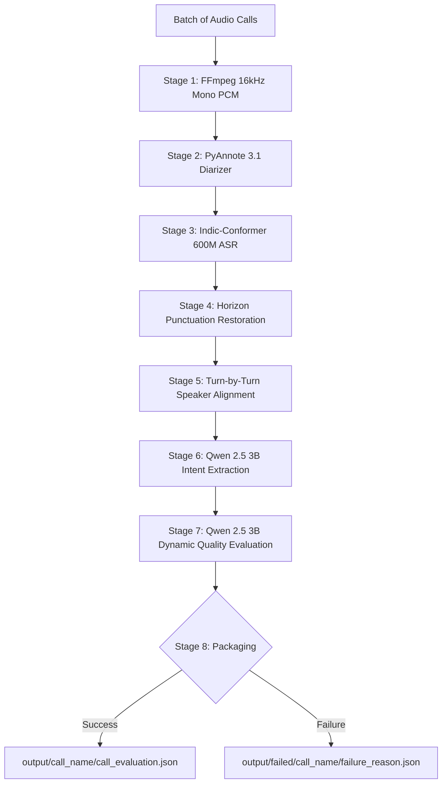

# Customer Support Call Intelligence Pipeline (v2)

A modular, production-ready speech intelligence pipeline that processes customer support audio calls end-to-end: speaker diarization, Indic speech-to-text (ASR), punctuation restoration, speaker-turn alignment, intent extraction, and granular call quality evaluation.

---

## 🚀 Key Features in v2

1. **Stage-by-Stage Batch Architecture**:
   - Each neural model is loaded onto the GPU **only once** for the entire batch of calls:
     - **PyAnnote Diarization** loaded once $\rightarrow$ diarizes all files $\rightarrow$ unloaded from VRAM.
     - **Indic-Conformer ASR** loaded once $\rightarrow$ transcribes all files $\rightarrow$ unloaded from VRAM.
     - **Horizon Punctuation** loaded once $\rightarrow$ restores punctuation for all files $\rightarrow$ unloaded.
     - **Qwen 2.5 3B LLM** loaded once $\rightarrow$ extracts customer intents & evaluates quality for all files $\rightarrow$ unloaded.
   - Saves intermediate outputs immediately per file.
   - Eliminates redundant model loading/offloading overhead by $O(N)$ times.

2. **Isolated Failure Segregation (`failed/` directory)**:
   - Any audio file that encounters an error in any stage is immediately moved into a dedicated `output/failed/<call_stem>/` directory.
   - Each failed record contains detailed diagnostic files:
     - `failure_reason.json`: Stage number, error message, audio metadata, and timestamp.
     - `error.txt`: Human-readable summary for fast terminal inspection.
   - The top-level `output/` directory contains strictly successful evaluation deliverables, keeping runs clean and production-ready.

3. **Dynamic Differentiated Quality Scoring**:
   - Evaluates agent performance dynamically with nuanced $\pm 5$ to $\pm 10$ variance across calls rather than static benchmark scores.
   - Strict rubric covering professionalism, respectfulness, politeness, customer issue resolution, and actionable agent feedback.

4. **Zero-Dependency Web Dashboard with Slide-Over Drawer**:
   - Built using Python standard library HTTP server (no Flask/FastAPI/Node required).
   - Real-time 8-stage stepper tracking per file.
   - Slide-over inspection drawer on the right side with `Next Call ➡️`, `⬅️ Prev Call`, counter, and keyboard shortcuts (`ArrowRight`, `ArrowLeft`, `Escape`).

5. **Safe Memory & Bounded Context**:
   - KV Cache bounded strictly via vLLM PagedAttention (`gpu_memory_utilization=0.60`).
   - Transcript chunking and hierarchical map-reduce ensure context windows never exceed model token limits.

---

## 📥 Cloning the Repository (v2)

To clone the `v2-main` branch onto your machine or cloud GPU instance (e.g. Google Colab):

```bash
# Clone the v2-main branch directly
git clone -b v2-main https://github.com/Gowthamsai-k/NLP_Call_.git
cd NLP_Call_
```

If you already have the repository cloned, switch to `v2-main`:
```bash
git fetch origin
git checkout v2-main
git pull origin v2-main
```

---

## 🛠️ Prerequisites & Setup

### 1. System Dependencies (FFmpeg)
FFmpeg is required for converting raw audio into standard 16 kHz mono PCM WAV:

```bash
# Ubuntu / Debian / WSL
sudo apt-get update && sudo apt-get install -y ffmpeg

# macOS (Homebrew)
brew install ffmpeg
```

### 2. Python Environment & Dependencies
Python 3.10+ is recommended.

```bash
python3 -m venv .venv
source .venv/bin/activate
pip install --upgrade pip
pip install -r requirements.txt
```

### 3. Hugging Face Authentication Token
PyAnnote Diarization requires accepting user terms on Hugging Face:
1. Accept the model terms for [pyannote/speaker-diarization-community-1](https://huggingface.co/pyannote/speaker-diarization-community-1).
2. Set your token as an environment variable:

```bash
export HF_TOKEN="hf_xxxxxxxxxxxxxxxxxxxxxxxxxxxxxxxxx"
```

---

## 💻 How to Run

### Method 1: Web Dashboard (Interactive UI)

The web dashboard allows you to drag-and-drop audio files or `.zip` archives, track progress in real-time, and inspect scorecards.

```bash
python3 dashboard_server.py --port 8000
```
*(Or via the main wrapper: `python3 main.py --dashboard --port 8000`)*

- Open your browser at: `http://localhost:8000`
- Upload your calls (`.mp3`, `.wav`, `.m4a`, etc.) or a `.zip` archive.
- Click **Run Pipeline Analysis**.
- Watch the live 8-stage stepper update for each file in real-time.
- Click any call name to open the side-drawer scorecard inspection.

---

### Method 2: Command Line (CLI)

#### Process a Folder of Audio Files (Stage-by-Stage Batch)
```bash
python3 main.py --input ./path_to_audio_folder/ --output ./output/
```

#### Process a Compressed Archive (`.zip`, `.tar`, `.tar.gz`)
```bash
python3 main.py --input ./customer_calls.zip --output ./output/
```

#### Process a Single Audio File
```bash
python3 main.py --input ./sample_call.mp3 --output ./output/call_1/
```

---

## ⚙️ Configuration & Environment Variables

You can tune parameters via environment variables without modifying code:

| Variable | Default | Description |
| :--- | :--- | :--- |
| `HF_TOKEN` | *None* | Hugging Face access token for PyAnnote. |
| `ASR_LANG` | `en` | Indic-Conformer target language (`en`, `hi`, `ta`, `te`, `kn`, etc.). |
| `ASR_DECODER` | `ctc` | Indic-Conformer decoder (`ctc` or `rnnt`). |
| `WHISPER_GPU_MEM` | `0.30` | GPU VRAM fraction allocated for ASR (default 30%, fits ~2.4GB on 8GB VRAM). |
| `INTENT_GPU_MEM` | `0.85` | GPU VRAM fraction for Intent Extraction LLM (default 85%, fits ~6.8GB on 8GB VRAM). |
| `EVAL_GPU_MEM` | `0.85` | GPU VRAM fraction for Evaluation LLM (default 85%, fits ~6.8GB on 8GB VRAM). |
| `INTENT_MAX_MODEL_LEN` | `8192` | Max context window tokens (fits comfortably in 8GB VRAM with eager mode). |
| `EVAL_MAX_MODEL_LEN` | `8192` | Max context window tokens (fits comfortably in 8GB VRAM with eager mode). |
| `CHUNK_TEXT_TOKENS` | `1200` | Slices long call transcripts into bounded chunks so context limits are never exceeded. |

> [!NOTE]
> **Out-of-the-Box 8GB VRAM Optimization**:
> The pipeline is pre-configured to run out-of-the-box on 8GB VRAM GPUs (e.g., RTX 5050, RTX Pro 2000 Blackwell) using `enforce_eager=True` (disabling bulky CUDA graph buffers) and sequential stage execution with dynamic token-bounded chunking.

---

## 📂 Output Directory Structure

After execution, deliverables are organized cleanly:

```
output/
├── call_01/
│   └── call_evaluation.json              # Final score deliverable (clean mode)
├── call_02/
│   └── call_evaluation.json              # Final score deliverable
├── failed/                               # Auto-created if any record encounters errors
│   └── broken_call_03/
│       ├── failure_reason.json           # Machine-readable error diagnostics
│       ├── error.txt                     # Human-readable failure summary
│       └── clean_16k.wav                 # Any partial artifacts generated prior to error
└── batch_processing_summary.json         # Complete batch execution summary
```

### Final Evaluation Deliverable (`call_evaluation.json`)
Contains:
- `audio_file`: Audio file name.
- `scorecard`: Numerical scores for `professionalism_score`, `respectfulness_score`, `politeness_score`, and `total_score` (0–100 scale) with detailed rationales.
- `evidence`: Categorized transcript quote citations supporting the assigned scores.
- `client_needs`: Explicit issues and needs articulated by the caller.
- `agent_actions`: Concrete steps taken by the customer service representative.
- `resolution`: Status (`resolved`, `partially_resolved`, `unresolved`, etc.) with explanation.

---

## 🏗️ Pipeline Architecture Flow


