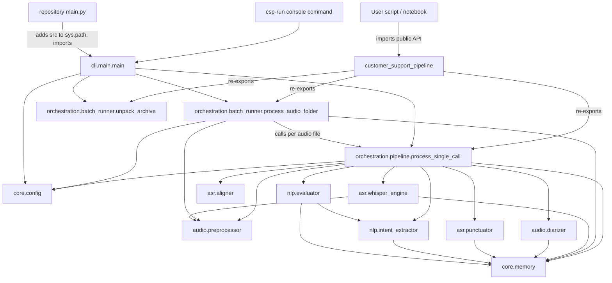

# Import, export, and data-flow graph

This graph follows the current code under `src/customer_support_pipeline`. The README's project tree and Python API examples describe an older layout.

## Python import and export graph



`customer_support_pipeline.__init__` defines `__all__` as `process_single_call`, `process_audio_folder`, and `unpack_archive`. These are the supported package-level exports. For example:

```python
from customer_support_pipeline import process_single_call, process_audio_folder
```

Other implementation functions are imported from their defining modules when needed; subpackage `__init__.py` files do not add more package-level exports. The installed `csp-run` command maps to `customer_support_pipeline.cli.main:main`. The repository-root `main.py` is a convenience wrapper that adds `src` to `sys.path` and calls the same CLI.

## Runtime data flow

```mermaid
flowchart LR
    Input[Audio file / directory / archive] --> CLI[CLI input router]
    CLI -->|archive| Extract[unpack_archive]
    CLI -->|directory or extracted archive| Batch[process_audio_folder]
    CLI -->|single file| Single[process_single_call]
    Extract --> Batch
    Batch -->|one isolated output directory per file| Single
    Batch --> Summary[batch_processing_summary.json]

    Single --> Convert[1. FFmpeg conversion]
    Convert -->|call_clean.wav| Diar[2. Pyannote diarization]
    Diar -->|call_metadata.json: speaker turns| ASR[3. Whisper ASR]
    Convert --> ASR
    ASR -->|whisper_transcript.json| Punctuation[4. Horizon punctuation]
    Punctuation -->|horizon_punctuated_transcript.json| Align[5. Temporal speaker alignment]
    Diar --> Align
    Align -->|call_transcript_with_speakers.json| Intent[6. Qwen intent extraction]
    Intent -->|intent_extraction.json| Evaluation[7. Qwen call evaluation]
    Align --> Evaluation
    Evaluation -->|call_evaluation.json| Final[Final outputs]
    Single --> Status[pipeline_status.json]
    Single -. optional cleanup .-> Intermediates[Removes WAV and intermediate JSON]
```



The coordinator checkpoints each intermediate/final file and skips stages whose output already exists when `resume=True`. It retries stages through `core.memory.retry_with_memory_cleanup`, releases GPU/model memory between model stages, and records success/failure in `pipeline_status.json`. Batch processing isolates failures per audio file and continues with the remaining files.

## Current module responsibilities

| Module | Imports from this project | Main public entry points / outputs |
| --- | --- | --- |
| `core.config` | none | Model IDs, prompts, schemas, limits, output filenames, retry defaults |
| `core.memory` | none | `release_memory`, `retry_with_memory_cleanup`, VRAM helpers |
| `audio.preprocessor` | `core.config` | Conversion, loading/resampling, turn slicing, audio file discovery |
| `audio.diarizer` | `core.config`, `core.memory` | `run_diarization` -> speaker-turn metadata |
| `asr.whisper_engine` | config, audio preprocessing, memory | `run_transcription` -> raw timestamped text segments |
| `asr.punctuator` | config, memory | `run_punctuation_restoration` -> punctuation-restored segments |
| `asr.aligner` | none | `align_speakers_with_transcript` -> speaker-tagged transcript |
| `nlp.intent_extractor` | config, memory | `run_intent_extraction` -> validated intent JSON; also `parse_json_object` |
| `nlp.evaluator` | config, intent extractor, memory | `run_call_evaluation` -> evaluation scorecard JSON |
| `orchestration.pipeline` | all stage modules, config, memory | `process_single_call` -> deliverable paths and stage status |
| `orchestration.batch_runner` | pipeline, preprocessing, config, memory | `unpack_archive`, `process_audio_folder` -> batch summary |
| `cli.main` | pipeline, batch runner, config | `main` -> routes CLI input to single/batch/archive flow |

## README drift to keep in mind

- The README shows a flat package tree (`pipeline.py`, `batch_processor.py`, etc.); current modules live in the subpackages shown above.
- Its API imports from `customer_support_pipeline.pipeline` and `customer_support_pipeline.batch_processor` do not match current paths. Use the package-level exports or `customer_support_pipeline.orchestration.*`.
- Its `python -m customer_support_pipeline.main` examples point to a module that does not exist. Use the installed `csp-run` command or run the repository wrapper as `python main.py`.
- The README describes an eight-stage sequence where the implementation has seven processing stages plus optional cleanup (stage 8 in its logs/comments).
